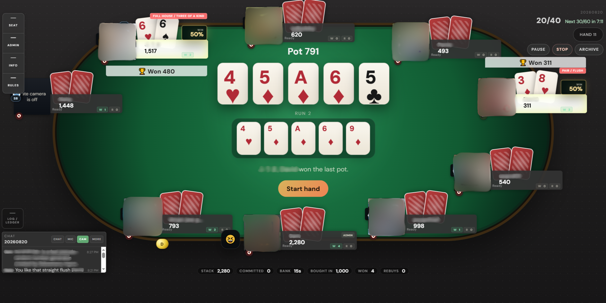
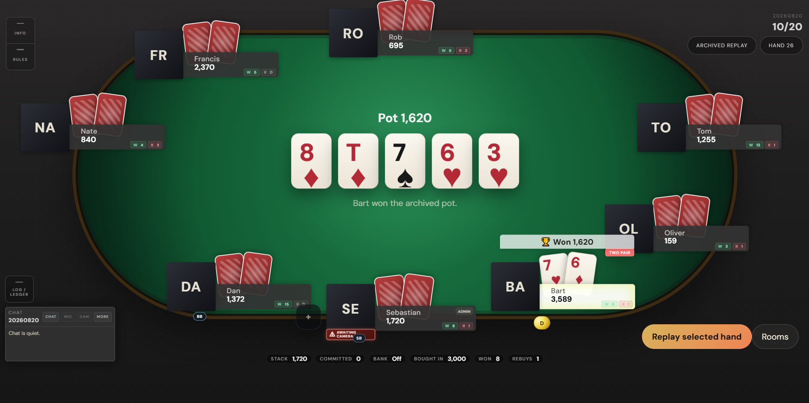

# Self-hosted Poker Night

Self-hosted Texas Hold'em for private games. It includes live tables, voice and video, chat, rebuys, blind schedules, club leaderboards, and archived hand replays.

<p align="center">
  <a href="img/desktop-table.png"></a>
  <a href="img/desktop-archive-table.png"></a>
</p>

## What it includes

- Private and club-based tables with password protection and seat approvals
- No-limit Hold'em with server-authoritative actions, side pots, all-ins, and run it twice
- Voice and video through self-hosted LiveKit
- Rebuys, blind schedules, time banks, auto-start, chat, reactions, and table controls
- Session ledgers, archived rooms, and replayable hands
- Clubs, leaderboards, and imported historical game results

## Quick Start

Requirements: Docker Engine with Docker Compose.

```sh
git clone https://github.com/estes-sj/Poker-Online.git poker
cd poker
cp .env.example .env
```

Edit `.env` before starting. At minimum, set a real public hostname for `LIVEKIT_NODE_IP` when players will connect outside your local network.

```sh
docker compose up -d --build
```

Open `http://localhost:3000` for local use. For a public deployment, put the web service behind HTTPS and use your configured domain.

To stop the stack:

```sh
docker compose down
```

Postgres data is stored in the `postgres-data` Docker volume. `docker compose down -v` removes it.

## Configuration

The tracked [`.env.example`](.env.example) documents the available settings. Copy it to `.env` and keep that local file out of Git.

| Setting | Purpose |
| --- | --- |
| `POKER_BRAND_NAME` | Display name for the instance, such as `Weeknight Poker` or `Poker Pro`. |
| `LIVEKIT_NODE_IP` | Public hostname or IP announced by LiveKit to browsers. |
| `LIVEKIT_WS_URL` | Browser-facing LiveKit signaling URL. `/livekit` works with the included same-host proxy setup. |
| `NEXT_PUBLIC_API_BASE_URL` | Browser-facing API base URL. |
| `NEXT_PUBLIC_GAME_HTTP_URL` | Browser-facing game HTTP URL. |
| `NEXT_PUBLIC_GAME_WS_URL` | Browser-facing game WebSocket URL. |
| `ROOM_CREATION_ADMIN_ONLY` | Restrict table creation to one configured account. |
| `GUEST_ACCOUNTS_DEFAULT_MODE` | Guest play without an account: `off`, `all` (every table), or `per-room` (host decides). The admin can change it later on `/admin/settings`, which takes precedence. |
| `ROOM_CREATION_ADMIN_USERNAME` | Username allowed to create tables when the restriction is enabled. |

House rules are stored in [`config/house-rules.json`](config/house-rules.json). The web service mounts this file at runtime, so updating it only requires restarting the web container:

```sh
docker compose restart web
```

Set `"visible": false` in that file to hide the House Rules control.

## Public Deployment

The included Compose configuration expects a single public hostname. Keep the browser-facing service URLs as same-origin paths:

```dotenv
NEXT_PUBLIC_API_BASE_URL=/api
NEXT_PUBLIC_GAME_HTTP_URL=/game
NEXT_PUBLIC_GAME_WS_URL=/game
LIVEKIT_WS_URL=/livekit
```

Your reverse proxy should send:

| Path | Destination |
| --- | --- |
| `/` | web service, port `3000` |
| `/game/*` | game service, port `4200`, including WebSocket upgrade headers |
| `/livekit` | LiveKit signaling, port `7880` |

The web application proxies `/api/*` and `/game/*` to the internal services. A proxy still needs WebSocket upgrade support for the game endpoint and a route for LiveKit signaling.

Camera and microphone access require HTTPS outside `localhost`.

### Media Ports

For remote voice and video, forward these ports to the host running LiveKit:

| Port | Purpose |
| --- | --- |
| `7880/tcp` | LiveKit signaling |
| `7881/tcp` | TCP media fallback |
| `50000-50100/udp` | Direct WebRTC media |
| `51000-51100/udp` | TURN relay media |
| `5349/tcp` | TURN over TLS |
| `3478/udp` | Optional TURN/STUN over UDP |

For clients on mobile or restrictive networks, configure TURN/TLS using `LIVEKIT_TURN_DOMAIN`, `LIVEKIT_TURN_CERT`, and `LIVEKIT_TURN_KEY`. The comments in `.env.example` describe the required certificate paths and alternative proxy-based setup.

## Development

The repository is a pnpm workspace:

```sh
pnpm install
pnpm dev:web
```

Useful commands:

```sh
pnpm build
pnpm typecheck
pnpm test
pnpm db:generate
pnpm db:push
```

The services are organized as follows:

| Path | Role |
| --- | --- |
| `apps/web` | Next.js web application |
| `apps/api` | Authentication, clubs, leaderboards, and media tokens |
| `apps/game` | Table runtime and WebSocket updates |
| `apps/worker` | Background reconciliation jobs |
| `packages/domain` | Poker rules and shared table state |
| `packages/db` | Prisma schema and database access |
| `infra/media` | LiveKit configuration |

## License

See [LICENSE](LICENSE).
